<p align="center">
  
</p>

<h1 align="center">Keystone</h1>

<p align="center">
  <b>Your hours, projects, deliverables, leave and notes in one app that runs on your own computer,<br>
  with an AI assistant that does the paperwork for you, one click to approve at a time.</b>
</p>

<p align="center">
  <a href="https://pypi.org/project/keystone-worklog/"></a>
  <a href="https://pypi.org/project/keystone-worklog/"></a>
  <a href="LICENSE"></a>
  
  
</p>

<p align="center">
  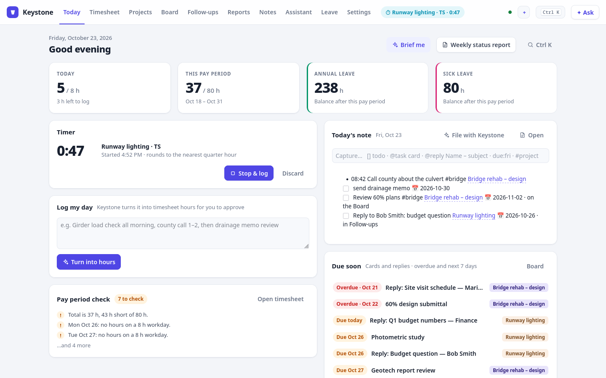
</p>

**Keystone** is a timesheet that checks itself, a project board, a leave planner and an Obsidian-powered notebook that can search inside every file you keep: PDFs, Office files, emails, Python and Abaqus jobs. An assistant ties them together and can log your hours, update your cards, write your notes and file your documents, but only after you click **Apply**.

It was built for people who charge time to **network/activity (NWA) numbers** on a biweekly pay period, with leave codes, budgets per project and a portal to paste hours into. It works just as well for anyone who wants a single place for hours, deadlines and notes.

```bash
pip install "keystone-worklog[all]"
keystone-worklog
```

---

## Why Keystone?

- ⏱️ **A timesheet that catches mistakes before you submit.** Missing days, short totals, holidays without holiday hours, projects over budget. It fills days from your schedule and copies hours straight into your time-entry portal.
- 📈 **Know when a budget runs out.** Burn-down per project, average hours per week, and a run-out date you can check by hand.
- 🗂️ **Your notes stay plain Markdown in Obsidian.** Projects, timesheets, deliverables and follow-ups are written into your vault. Tick a checkbox in Obsidian and the Board updates.
- 🔎 **Find any file by what's inside it.** PDFs, Word, PowerPoint, Excel, saved emails, Python scripts, notebooks and solver files (Abaqus `.inp`/`.msg`/`.dat`/`.sta`) are searched by keywords and by meaning, and results point to the page, slide, sheet or function.
- 📥 **An inbox that files itself.** Drop files into `Inbox/` and Keystone suggests where each one belongs, from similar files and job names already in your vault. Review the table, click **Move**, undo if needed.
- 📊 **Plan projects like in MS Project.** A Gantt you can drag, milestones, dependencies and the critical path, who's working on what, baselines, and an issues & risks log. Opens and saves MS Project XML, and shows the hours you've charged on the timesheet against each task.
- 💵 **Run the project, not just the plan.** Paste or upload the ERP export for the whole team (you pick the columns once), add the charges the ERP leaves out, and get earned value, CPI/SPI, a forecast and the date the money runs out. Close the week for a red/amber/green status report, and see every plan and person on one page.
- 🤖 **An assistant that works with you.** "Log 8 hours to each project for today." "Push every card without a date to next Friday." "Summarize this note." Every change shows up as a diff to **Apply** or **Reject**, and can be undone.
- 🔒 **Local-first and private.** Keystone runs on `127.0.0.1`. Use a local model (Ollama, LM Studio, llama.cpp) and nothing leaves your machine. API keys never reach the browser.
- ⚡ **Fast on big vaults.** Listing never opens files, OneDrive online-only files aren't downloaded, folders can be skipped, documents are read in a separate process, and embedding runs on your GPU (WebGPU) when there is one.
- ✈️ **Works without internet.** One command bundles Keystone, its Python packages and the embedding model for an air-gapped computer.

---

## A quick tour

### 🗓️ A timesheet that checks itself
Two Sun–Sat weeks per pay period, with pay codes (RG, LA, LS, LH) and telework. The **pay-period check** lists everything to fix before you submit. **Fill from schedule** tops every day up to your 5×8, 9/80 or 4×10 schedule, and federal holidays are filled in for you. **Copy for portal** puts the week on your clipboard in your portal's column order. **Mark as submitted** locks the period.

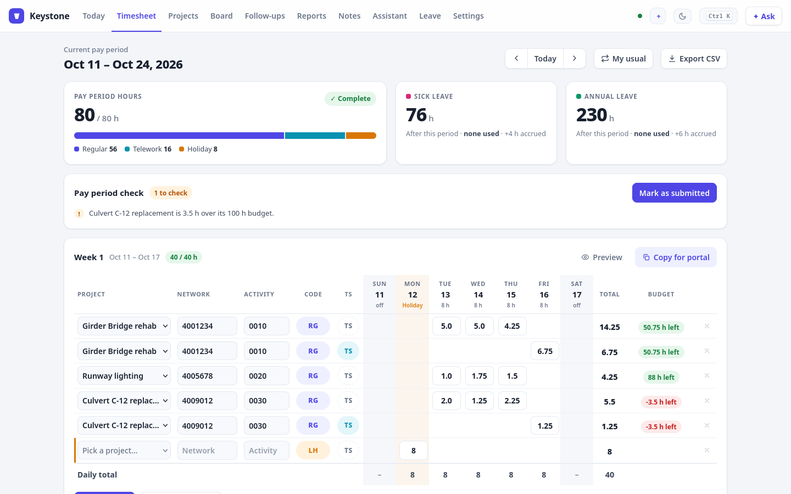

### 🤖 Ask Keystone, beside every page
Open the assistant with **✦ Ask** or `Ctrl+J`. It searches and reads your vault (by keywords *and* by meaning, using a small model that runs in your browser), including what's **inside your PDFs, Word, PowerPoint and Excel files and saved emails**, so it can find a file for you and tell you the page. It knows which page you're on and proposes changes for you to approve. Bring any OpenAI-compatible model: a **local Gemma or Llama**, or a cloud provider.

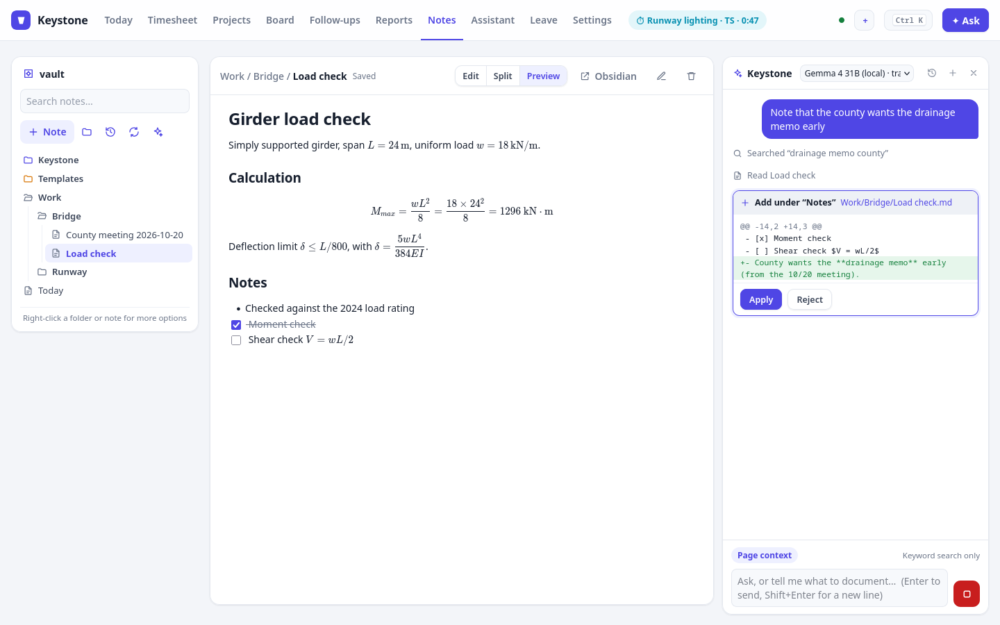

### 🔎 Search inside every file, and file the inbox
Keystone reads the documents in your vault on your own computer and embeds them with a small model that runs in your browser, so the assistant finds files by what they say. Solver output gets an **Errors, warnings and status** summary, so *"why did girder_v3 fail?"* finds the right `.msg`. New files dropped into `Inbox/` get a suggested folder each; you review them in one table.

| A solver message file in the Notes tab | File the inbox |
| --- | --- |
| 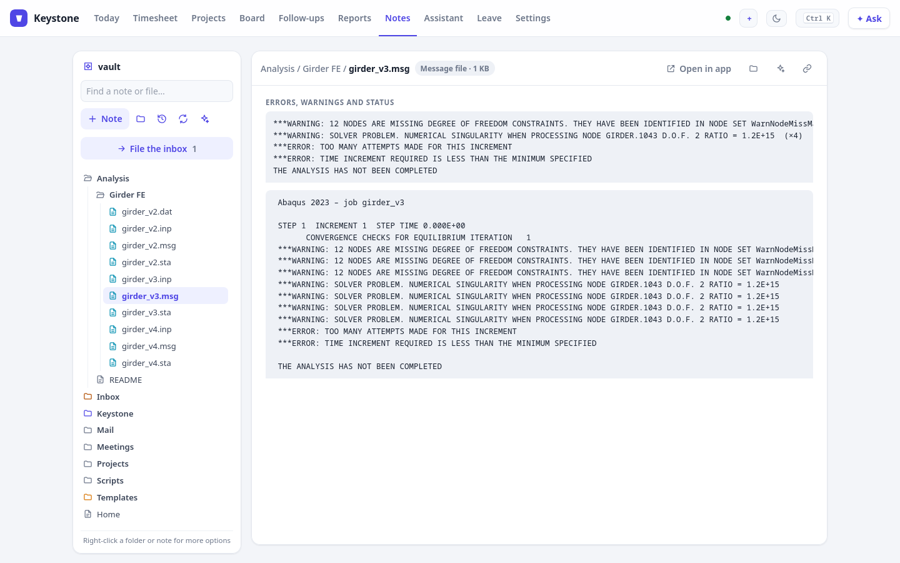 | 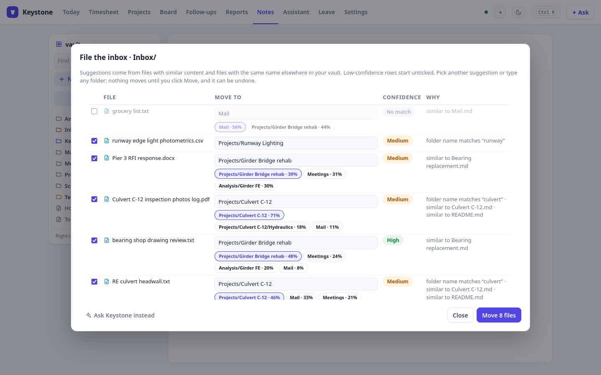 |

**Settings → Search index** shows which files have been read and embedded, what's waiting and anything that couldn't be read, and an *Indexing 43%* chip in the top bar shows progress while it runs.

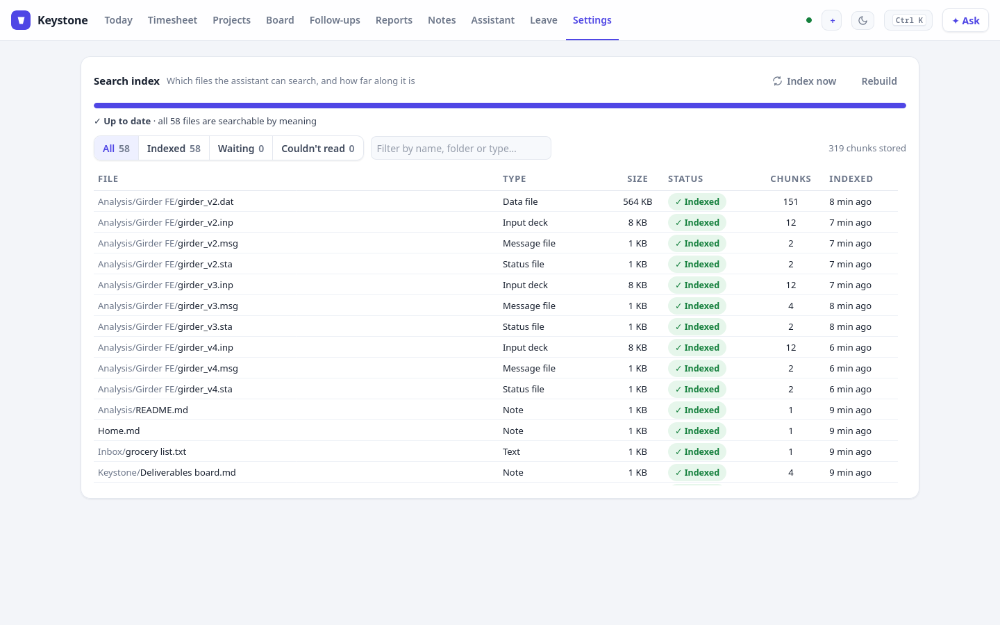

### 📊 Project planning with a Gantt you can drag, and MS Project in and out
The **Plan** tab is a project scheduler that works like MS Project: build the schedule in a spreadsheet-style grid, or drag it into shape on the timeline. It works out the critical path, slack, late tasks and missed deadlines on your own work schedule and holidays. Then it shows who is doing what, what's at risk and how much of the budget is spent. Plans open from and save to **MS Project**, and nothing in the file is lost on the way through.

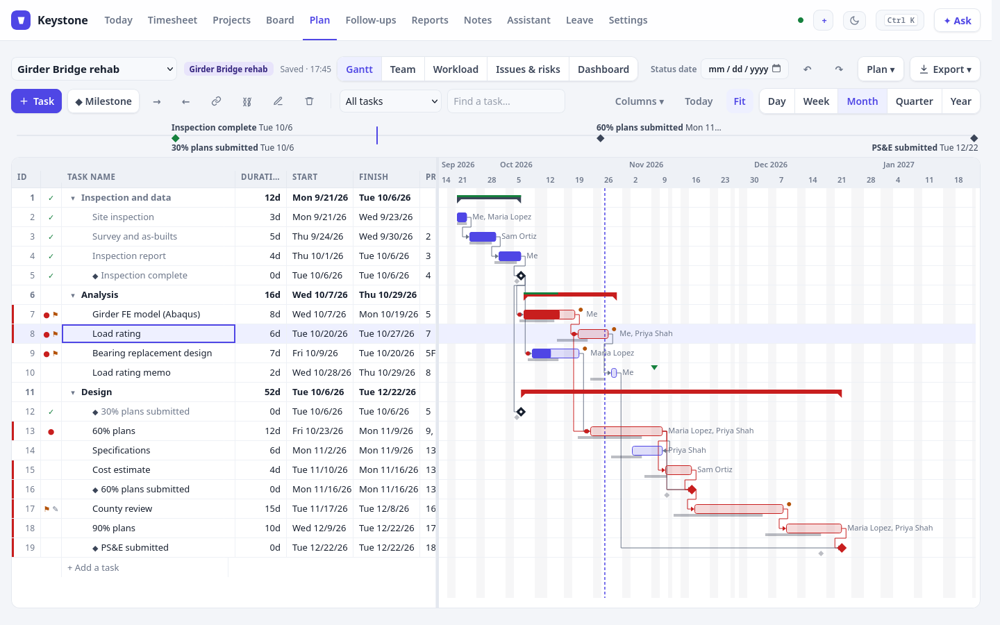

**Plan it**
- **Type like a spreadsheet:** durations `3d`, `2w`, `0` for a milestone; predecessors `4, 7SS+2d, 9FF`; people `Maria, Sam[50%]`. `Alt+Shift+→` indents a task into a phase, `Ctrl+Z` undoes.
- **Or drag on the timeline:** move a bar, stretch it, drag its progress, or drag from one bar onto another to link them. The whole schedule moves live as you drag.
- **Scheduled like MS Project:**
  - all four link types with lead and lag;
  - all eight constraint types, deadlines and manually scheduled tasks;
  - the **critical path** in red, slack, and a red dot on anything late.
- **Baselines 0–10** draw what you first planned as grey bars under each task, so slips are obvious.
- **Status date** and **Update progress**: mark work as done up to a date, as in MS Project's *Update Project*.
- **Templates:** save a plan as a template and start the next project from it.

**Run it**

| Team planner – drag a bar to another person to reassign it | Workload – planned hours per person per week |
| --- | --- |
| 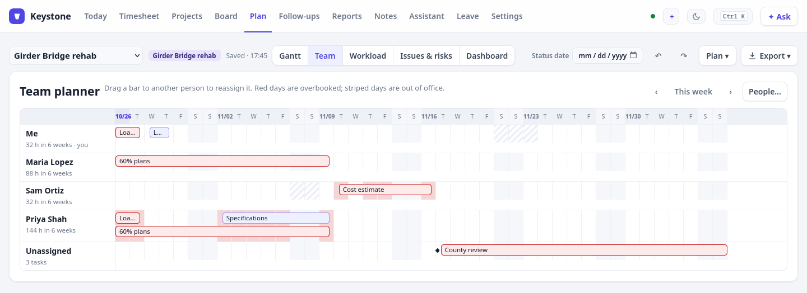 | 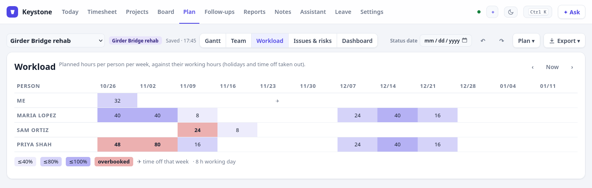 |
| **Issues & risks** – a RAID log with a 5×5 risk matrix | **Dashboard** – finish against baseline, progress, hours, what's late |
| 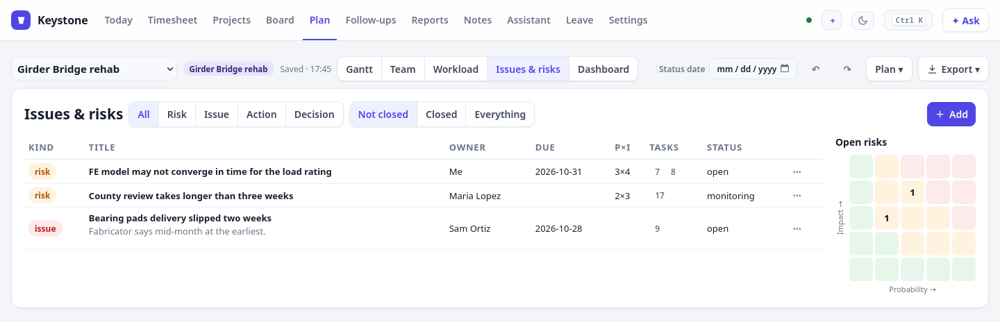 | 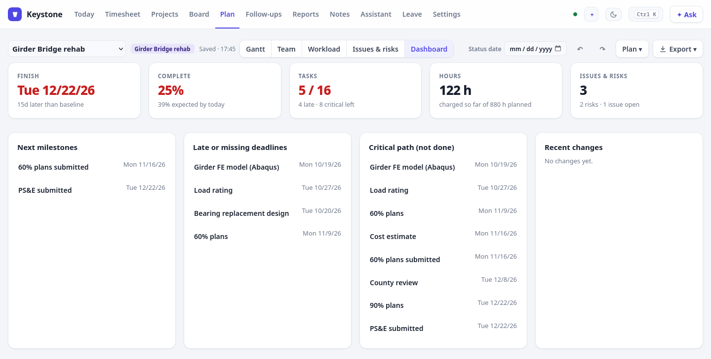 |

- **People and time off:** your own leave and travel come from the Keystone calendar, and you set other people's days off and *Max %*. Overbooked days turn red.
- **Hours from your timesheet:** link a task to a network/activity and the plan shows hours **charged** against hours **planned**.
- **Today page:** a *Plans* card lists your late tasks, this week's tasks and the next milestones across every plan.
- **Ask Keystone:** *"What's driving the finish date?"*, *"What if the FE model takes 4 more days?"* (a what-if that changes nothing), *"Add a QA check after the load rating, 2 days, Priya."* Every change shows how it moves the finish date before you **Apply** it, and can be undone.

**Work with MS Project**

| Open an MS Project file – a preview before anything is created | Export – back to MS Project, Excel, calendars, Obsidian or PDF |
| --- | --- |
| 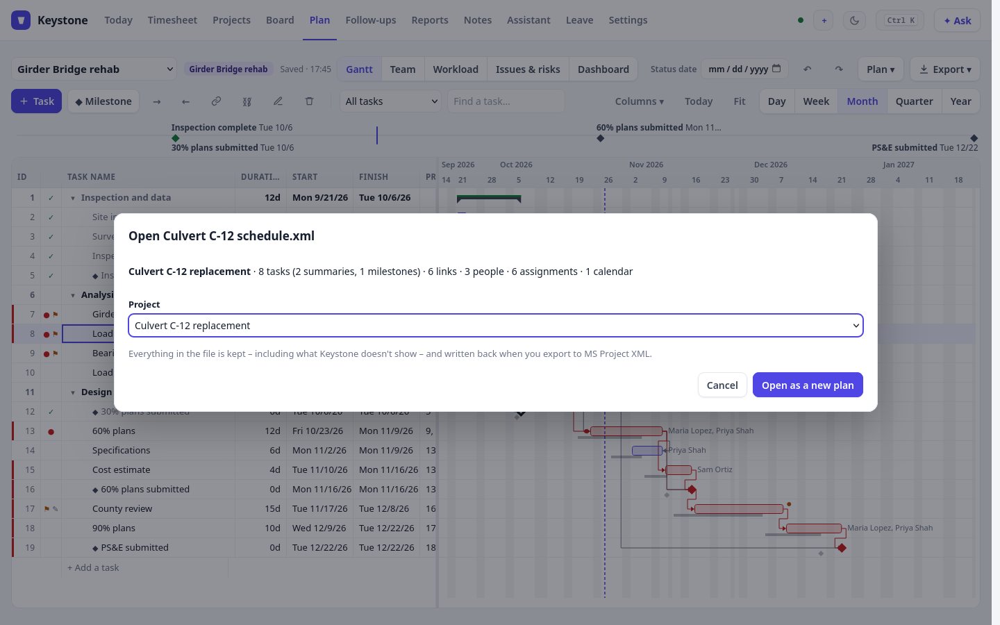 | 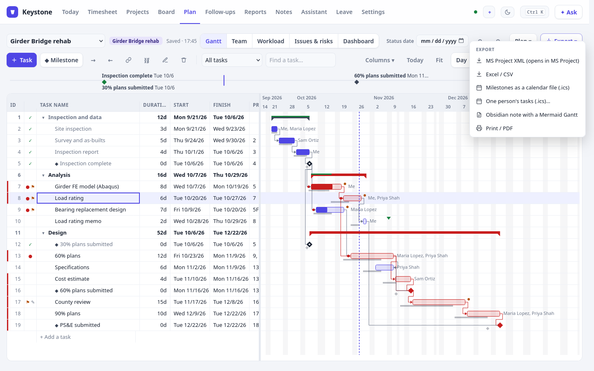 |

1. **From MS Project:** open your plan and use **File → Save As → XML** (*XML Format (\*.xml)*). Keystone reads that format with nothing extra installed.
2. **Into Keystone:** **Plan ▾ → Open an MS Project file** (or `Ctrl+K` → *Open an MS Project file*), pick the `.xml`, check the preview and choose the project. Then **Open as a new plan**. Tasks, phases, links, constraints, deadlines, progress, people, assignments, calendars and baselines all come across.
3. **Work on it** in Keystone: drag, re-link, update progress, set a baseline.
4. **Back to MS Project:** **Export ▾ → MS Project XML**, then in MS Project use **File → Open** and pick the `.xml`. It opens as a normal project you can save as `.mpp`.
5. **Got a newer version from someone else?** **Plan ▾ → Update from an MS Project file** merges it into the open plan. It lists what was added, removed and changed, and keeps your links to timesheet NWAs, Board cards and files.

- **Nothing is lost:** fields Keystone doesn't show (costs, custom fields, outline codes, extra calendars) are kept and written back on export.
- **`.mpp` files** can be opened directly once [MPXJ and Java are installed](#reading-mpp-files-optional), no admin rights needed. Keystone always exports XML, which MS Project opens directly.
- **Try it:** the demo includes `demo/Culvert C-12 schedule.xml`.

### 💵 Team costs, earned value and the weekly status report
The timesheet tracks your hours; the **Costs** view tracks the whole team's. Run your ERP's labor report and **Import from ERP**: drop the Excel or CSV file, or paste the rows. You choose which column is the date worked, the posting date, the person, hours, pay and fringe **once**, and save it as your master layout, so every later import goes straight to the preview. A new export replaces the period it covers (corrections included), and the last import can be undone.

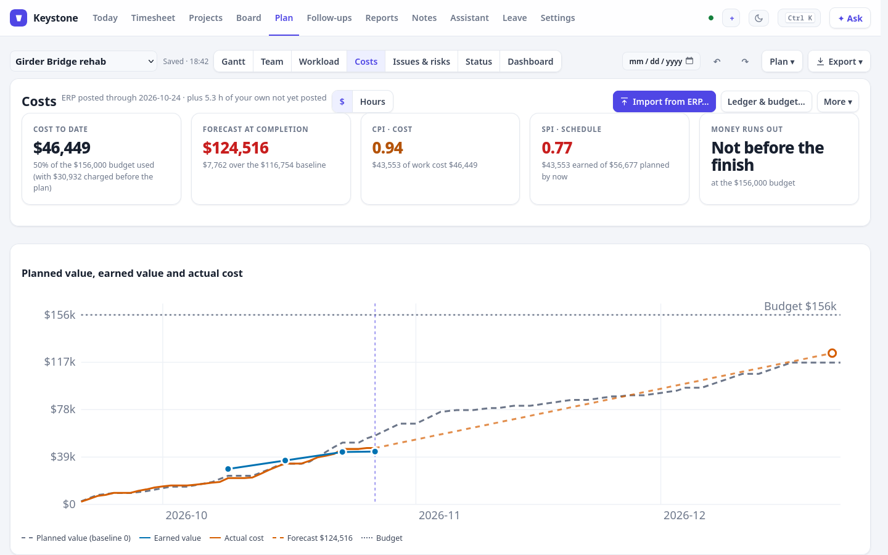

- **People & rates:** one team list for every plan, with each person's ERP aliases and dated pay rates.
- **Cost models:** the ERP gives pay and fringe; you add what it leaves out (overhead, service charges, $/hour fees, a fee on the total). Each project picks its model, and every number shows its working.
- **Estimate each task:** type the hours it needs (the duration follows from the people on it) and, if you like, a dollar budget as a separate check. Baseline, planned, actual and forecast sit side by side, and anything heading over turns red.
- **Earned value:** planned cost from people's rates, saved with the baseline. Actual cost goes on the tasks *that person* was scheduled on that day. You get CPI, SPI, the forecast at completion, the date the money runs out, and an S-curve.
- **Close the week:** red/amber/green suggested from the numbers (a reason is needed to override it), drafted *done* and *next* lists, and a frozen snapshot. The **status report** is written from it as an Obsidian note, an Outlook email draft or a PDF. The **milestone trend** chart shows what's slipping a little each week.
- **All plans:** every plan's status, finish, cost and next milestone; every milestone on one timeline; each person's load across all plans; and *who's free* for the next job.

| Import from the ERP – columns chosen once, saved as the master layout | Close the week – suggested status, drafted report |
| --- | --- |
| 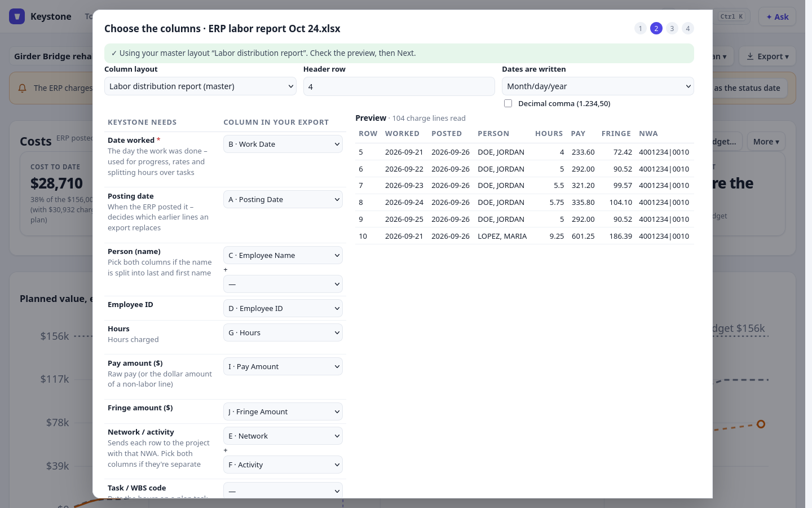 | 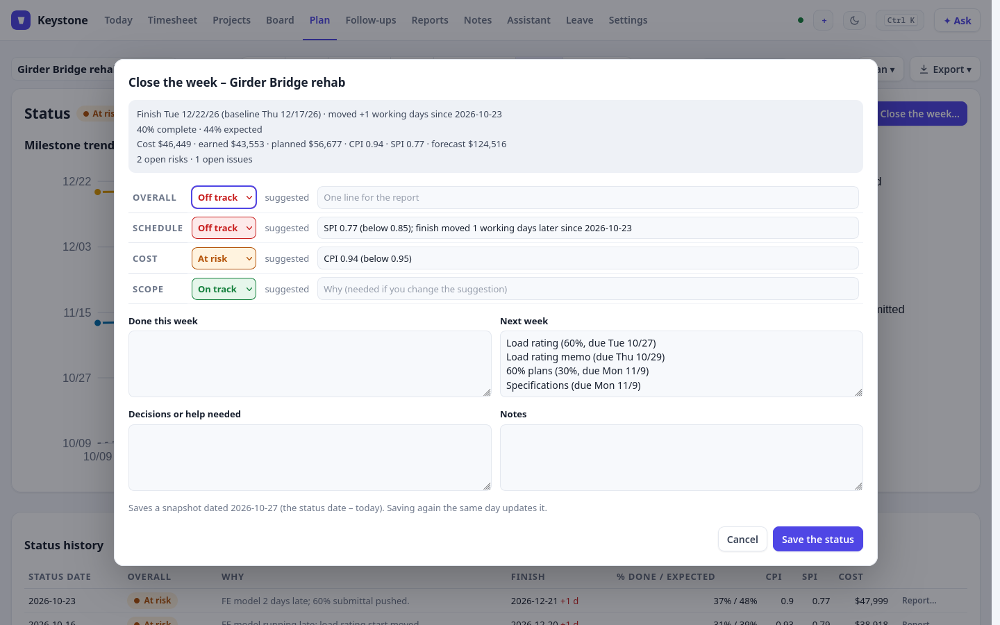 |
| **Status** – milestone trend and history | **All plans** – status, cost and milestones across projects |
| 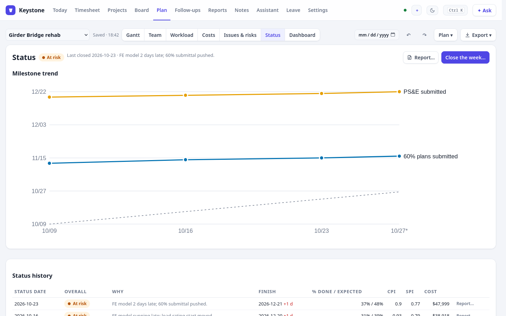 | 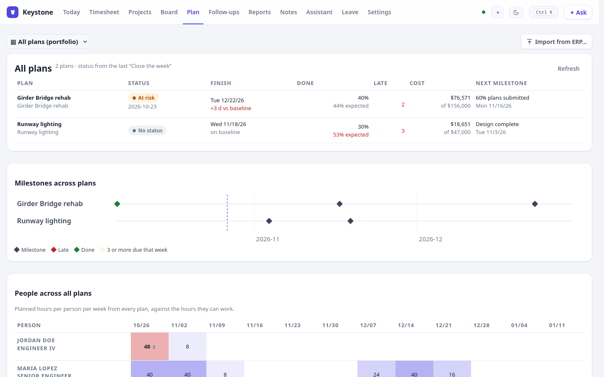 |

Pay data never leaves your computer: rates are in owner-only files, and an AI profile only sees dollar amounts when you turn on **Allow cost data** for it. Pay rates are never sent.

### 📋 Deliverables, leave and meetings on one calendar

| Kanban board | Calendar |
| --- | --- |
| 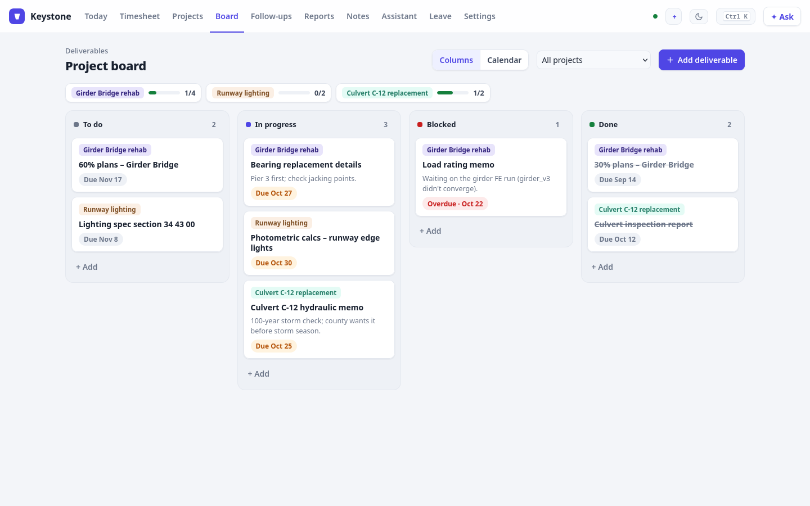 | 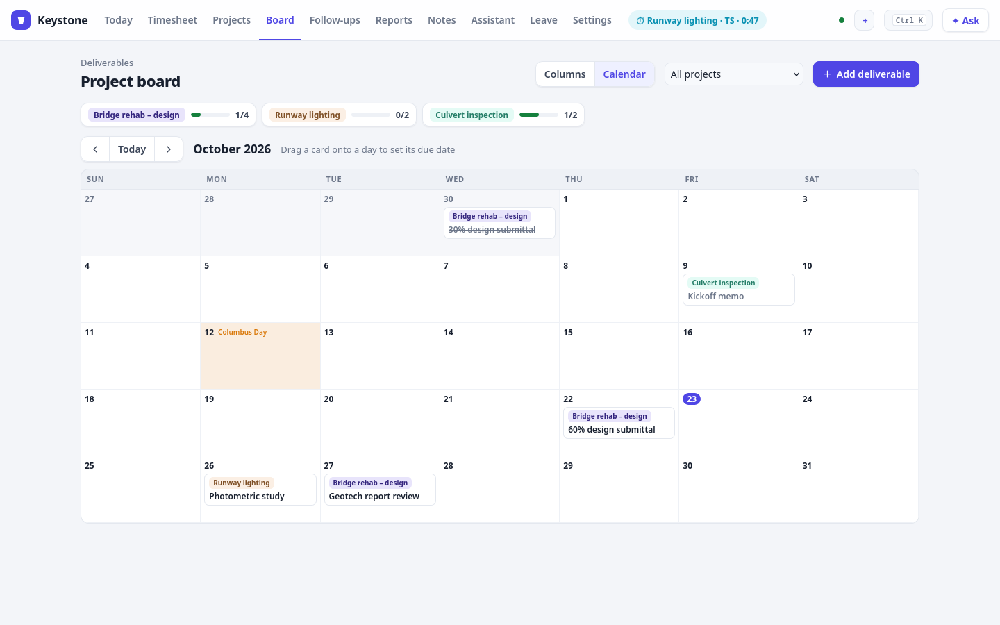 |

Mark annual leave, sick leave or travel as **Out of office**; leave can put its hours on the timesheet for you and shows the balance it leaves. Import an `.ics` file from Outlook, Google or Apple to see meetings and charge their time to a project.

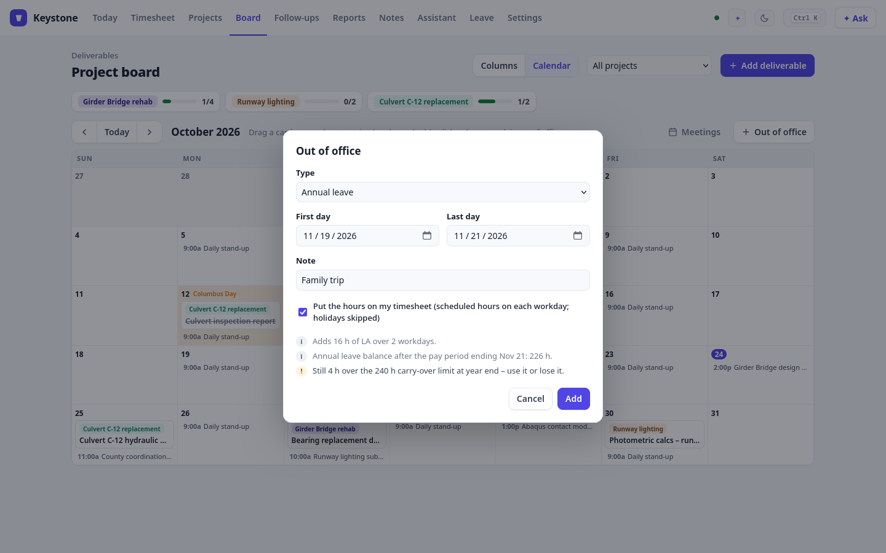

### 📈 Budgets, leave and hours at a glance
Burn-down per project with a run-out date, a burn-rate table for every project, a leave forecast with a **use-or-lose** warning, hours by project for the last 6 months or a whole year (CSV or a vault note), and a history of submitted pay periods. **Print / PDF** gives a clean report.

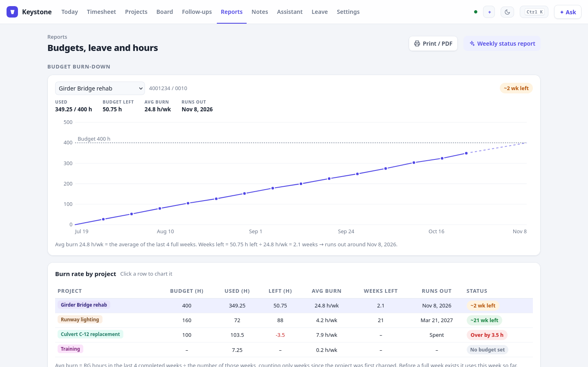

### ✉️ Never lose an email you owe a reply to

| Follow-ups | Quick capture (`Ctrl+Shift+Space`), dark mode |
| --- | --- |
| 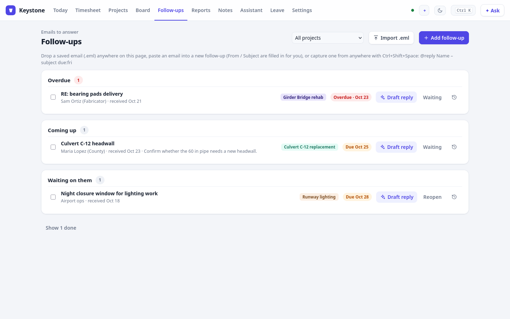 | 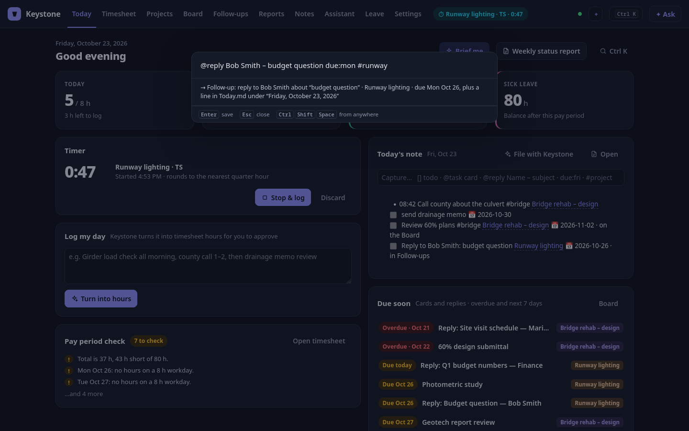 |

Drop in a saved email or paste one from Outlook, set a reply-by date, and let Keystone **draft the reply** (it never sends anything). Quick capture turns one line into a note, a to-do, a Board card or a follow-up, all logged in a single `Today.md` with a heading per day.

---

## Quick start

**Requirements:** Python 3.10+ and a modern browser (Firefox, Chrome or Edge). Obsidian, Git and an AI model are all optional.

```bash
pip install "keystone-worklog[all]"      # or plain keystone-worklog: no meaning search or document reading
keystone-worklog                          # opens http://127.0.0.1:5000 — stop with Ctrl+C
```

**Try it with demo data first** (from a source checkout – a fictional vault with projects, specs, emails and Abaqus jobs, and an inbox to file; your own data is not touched):

```bash
python scripts/make_demo.py                     # creates ./demo (also two project plans, team costs and ERP exports for the Plan tab)
KEYSTONE_DATA_DIR=demo/data python app.py --port 5050
```

**Your first five minutes:**

1. **Settings → Pay period:** set a real pay-period start date (a Sunday) and your hours per period.
2. **Settings → Work schedule & holidays:** pick 5×8, 9/80 or 4×10 (or make your own), and enter your leave balances and accrual rates.
3. **Projects:** add each network + activity you charge to, with a name and an hour budget.
4. **Timesheet:** pick a project on each row and type hours, or use **Fill from schedule**. At the end of the week: **Copy for portal**, paste, done.
5. *(Optional)* **Settings → Obsidian vault:** choose your vault to get Markdown notes, the Notes tab and quick capture.
6. *(Optional)* **Settings → AI assistant:** add a profile for your local or cloud model, then press **Test connection**.

---

## Using Keystone day to day

| When | What to do |
| --- | --- |
| **Morning** | Open **Today**: hours to log, what's due, replies owed. Click **Brief me** for a summary from the assistant. |
| **During the day** | `Ctrl+Shift+Space` to capture anything. Start the **timer** when you switch tasks. |
| **End of day** | Stop the timer, or type what you did into **Log my day**, and the assistant turns it into timesheet hours. |
| **New files** | Drop them into `Inbox/` in your vault, then **Notes → File the inbox**. |
| **Friday** | **Weekly status report** drafts your report from hours, the Board and this week's notes, and saves it to your vault. |
| **End of pay period** | Clear the **pay-period check**, **Copy for portal**, then **Mark as submitted**. |

### Keyboard shortcuts

| Keys | Action |
| --- | --- |
| `Ctrl+K` | Search everything and run commands: notes, projects, cards, "Start timer", "File my inbox", "Next pay period"… |
| `Ctrl+Shift+Space` | Quick capture from anywhere |
| `Ctrl+J` | Open or close the assistant |
| `↑ ↓ ← →`, `Enter` | Move between hour cells on the timesheet |
| `Ctrl+S` | Save the note you're editing (notes also autosave) |

### Quick-capture syntax

| You type | You get |
| --- | --- |
| `Call the county about the culvert #bridge` | A timestamped line in `Today.md`, linked to the *Bridge* project note |
| `[] send drainage memo due:fri` | A checkbox with a due date |
| `@task Review 60% plans due:2026-11-02 #bridge` | A card on the Board, plus a line in `Today.md` |
| `@reply Bob Smith – budget question due:tomorrow` | A follow-up, plus a line in `Today.md` |

`due:` understands `today`, `tomorrow`, weekday names, `+3d`, `2w` and `YYYY-MM-DD`.

### Things to ask the assistant

> *"Log 8 hours to each project for today."* · *"How many hours do I still need this pay period?"* · *"What's overdue on the Board?"* · *"Set a due date of next Friday on every card that has none."* · *"Summarize the note I have open and pull out the action items."* · *"Draft a reply to my oldest follow-up."* · *"How much annual leave will I have on December 31?"* · *"Find the spec that covers elastomeric bearing pads."* · *"Which email from the county mentioned the culvert deadline?"* · *"Why did girder_v3 fail?"* · *"File my inbox."* · *"What's late on the bridge plan and what's driving the finish date?"* · *"What if the load rating takes a week longer?"* · *"Who is burning the bridge budget?"* · *"Who has 40 hours free in the first half of November?"* · *"Draft this week's status for the bridge plan."*

---

## Configuration

| Option | What it does |
| --- | --- |
| `keystone-worklog --port 5001` | Use another port (or set `KEYSTONE_PORT`) |
| `keystone-worklog --no-browser` | Don't open a browser window |
| `keystone-worklog --models-dir PATH` | Use an offline embedding-model bundle (see below) |
| `keystone-worklog --offline` | Never connect to the internet (or set `KEYSTONE_OFFLINE=1`) |
| `KEYSTONE_INDEX_DIR=PATH` | Keep the search index somewhere else (by default it moves out of OneDrive/Dropbox folders by itself) |
| `KEYSTONE_SLOW_LOG=0.5` | Log requests slower than this many seconds to the console (default 2) |
| `KEYSTONE_DATA_DIR=PATH` | Keep the data in another folder, e.g. a second profile |

**Where your data lives:**

| OS | Data folder |
| --- | --- |
| Linux | `~/.local/share/keystone-worklog` |
| macOS | `~/Library/Application Support/keystone-worklog` |
| Windows | `%APPDATA%\keystone-worklog` |

The data folder holds your tracker data, a dated backup for every day you use Keystone, assistant chats and API keys (owner-only). Restore a backup from **Settings → Reminders & backups**.

**AI models:** any server with an OpenAI-compatible `/chat/completions` API works.

| Provider | Base URL |
| --- | --- |
| Ollama (local) | `http://localhost:11434/v1` |
| LM Studio (local) | `http://localhost:1234/v1` |
| llama.cpp / vLLM (local) | `http://localhost:8080/v1` |
| OpenAI | `https://api.openai.com/v1` |
| OpenRouter | `https://openrouter.ai/api/v1` |

Each profile has an **Allow tracker access** switch. Turn it on for your local model and off for a cloud one, and your hours, budgets and leave never reach the cloud.

### Computers without internet

On a machine **with** internet:

```bash
keystone-worklog-bundle --platform win_amd64 --python-version 3.12   # match the offline computer
```

Copy the resulting `models/` and `wheels/` folders over, then on the offline machine:

```bash
pip install --no-index --find-links wheels "keystone-worklog[all]"
keystone-worklog --models-dir models --offline     # --offline: never connects to the internet
```


### Reading .mpp files (optional)

Keystone runs without Java. The Plan tab, Gantt and MS Project **XML** import and export all work out of the box. Java and [MPXJ](https://www.mpxj.org) are needed for one thing only: opening `.mpp` (and `.mpx`/`.mpt`) files directly. Without them, open the file in MS Project and use **File → Save As → XML**, then import that. Keystone never writes `.mpp`; it exports MS Project XML, which MS Project opens with **File → Open**.

Neither step below needs admin rights.

**1. MPXJ** – install it into the same Python environment that runs Keystone. Keystone finds it by itself:

```bash
pip install mpxj                          # same venv as Keystone, or: pip install "keystone-worklog[mpp]"
pip install --user mpxj                   # if Keystone is installed for your user with the system Python
pipx inject keystone-worklog mpxj         # if Keystone was installed with pipx
```

**2. Java** – download the **Eclipse Temurin JRE** (version 21, x64) archive from [adoptium.net/temurin/releases](https://adoptium.net/temurin/releases/): the `.zip` for Windows or the `.tar.gz` for Linux. Don't use the `.msi`/package installers; they need admin rights. Unpack it in your own folder and point `JAVA_HOME` at it.

Windows (PowerShell):

```powershell
Expand-Archive "$HOME\Downloads\OpenJDK21U-jre_x64_windows_hotspot_*.zip" "$env:LOCALAPPDATA\Programs\Java"
$jre = (Get-ChildItem "$env:LOCALAPPDATA\Programs\Java" -Directory | Select-Object -First 1).FullName
[Environment]::SetEnvironmentVariable("JAVA_HOME", $jre, "User")   # your account only – no admin
& "$jre\bin\java.exe" -version                                       # check it runs
```

Linux:

```bash
mkdir -p ~/.local/java
tar -xzf ~/Downloads/OpenJDK21U-jre_x64_linux_hotspot_*.tar.gz -C ~/.local/java
echo 'export JAVA_HOME="$(ls -d ~/.local/java/jdk-* | head -1)"' >> ~/.bashrc
source ~/.bashrc && "$JAVA_HOME/bin/java" -version                  # check it runs
```

Then **restart Keystone from a new terminal** (so it sees `JAVA_HOME`) and use **Plan ▾ → Open an MS Project file** to pick an `.mpp`. If something is still missing, the message says which part. Keystone looks for `java` on your `PATH` first, then in `JAVA_HOME`. To use MPXJ jars you downloaded yourself, set `KEYSTONE_MPXJ` to their folder.

**Offline computers:** on a connected machine, run `pip download mpxj --no-deps -d wheels` and download the Temurin archive. Copy both over, then run `pip install --no-index --find-links wheels mpxj` and unpack Java as above.

**Locked-down work PCs:** some company policies block programs started from your own folders. If `java -version` is blocked, ask IT for Java, or stick with **Save As → XML**.

---

## Privacy and security

- **Your computer only:** Keystone listens on `127.0.0.1` and refuses requests addressed to any other host.
- **Documents are read, never changed:** PDFs, Office files, emails and text files are read on this computer to search them; their text is cached in `data/index/docs/`. **Open in app** only opens documents, notes and images – never programs or scripts.
- **Notes stay in the vault:** the Notes tab and the assistant can only read and write `.md` files inside the vault you chose. Paths that escape it, hidden folders and symlinks pointing outside are refused.
- **Nothing is ever deleted or overwritten.** The assistant can create, edit, append to and move notes, and move files when filing; it can't delete. Moving a batch of files is one undo, and only files git already tracks are committed. Every change is a diff you approve, can be undone, and (optionally) becomes its own Git commit in your vault.
- **API keys stay on the server**, in an owner-only file, and are never sent back to the browser.

---

## Documentation

The **[user guide](docs/GUIDE.md)** covers every feature in detail:
- pay codes and the portal format;
- the Obsidian export and two-way sync;
- the Notes editor, templates, math and images;
- every assistant tool and the meaning-search index;
- searching documents, solver files and code, and the search index status;
- filing the inbox, out-of-office days, calendar import and the timer log;
- backups and Git history.

---

## Development

```bash
git clone https://github.com/<you>/keystone-worklog && cd keystone-worklog
python -m venv .venv && source .venv/bin/activate        # Windows: .venv\Scripts\activate
pip install -e ".[all]"
python app.py                                            # runs from the checkout, with data in ./data

python -m unittest discover -s tests -v                 # Python tests (no extra packages needed)
node --test tests/js/*.test.mjs                          # JavaScript tests (Node 18+, built-in runner)
```

| Path | What's there |
| --- | --- |
| `keystone_worklog/app.py` | Flask server and the `keystone-worklog` command |
| `keystone_worklog/static/index.html` | The whole web app in one file: HTML, CSS and JavaScript, no build step |
| `keystone_worklog/assistant.py` | Model profiles, chat proxy, vault tools, undo, Git commits |
| `keystone_worklog/vault.py` | Markdown export to Obsidian and syncing ticks back |
| `keystone_worklog/vector_index.py` | Note and document chunking and the LanceDB index |
| `keystone_worklog/documents.py` | Text from PDF, Word, PowerPoint, Excel, emails, code, notebooks and solver files |
| `scripts/make_demo.py` | Builds the demo data used for the screenshots |
| `tests/` | Python tests, a mock OpenAI-compatible server, and `tests/js/` |

Contributions are welcome. Please open an issue to discuss bigger changes, and make sure both test suites pass. Continuous integration runs them on Linux, Windows and macOS. Releases go to PyPI automatically when a GitHub Release is published (see the [user guide](docs/GUIDE.md#releasing-maintainers)).

---

## License

[MIT](LICENSE). Bundled components (marked, DOMPurify, KaTeX), the optional document readers (pypdf, python-docx, python-pptx, openpyxl) and the downloaded embedding model keep their own licenses, see [THIRD_PARTY_NOTICES.md](THIRD_PARTY_NOTICES.md).
