# Keystone without an AI model

Everything Keystone does works without an AI model, offline, on your own computer. You don't need an API key, a
local LLM or an internet connection. This page is a getting-started guide for working that way. It covers:
- the pages and buttons;
- **slash commands** (`/log 2h #girder`), which do in one line what would otherwise take several clicks;
- **exact search** (`/grep`, `/todos`), which finds text across your notes line by line.

An AI model is optional, and you can add one later. Every command keeps working the same way after you do.

> **Try it on the demo first.** In a source checkout, `python scripts/make_demo.py` builds a fictional vault with
> three projects, a Board, follow-ups and two project plans. Then run
> `KEYSTONE_DATA_DIR=demo/data python app.py --port 5050`. Your own data is not touched. The examples and screenshots
> on this page use that demo, so `#girder`, `#culvert` and `#runway` are its projects.

**Contents**
1. [Set up (five minutes)](#1-set-up-five-minutes)
2. [Where to type commands](#2-where-to-type-commands)
3. [How a command works](#3-how-a-command-works)
4. [Your first day](#4-your-first-day)
5. [Adding tasks: which kind, and how](#5-adding-tasks-which-kind-and-how)
6. [Everything else, area by area](#6-everything-else-area-by-area)
7. [Finding things: search, grep and todos](#7-finding-things-search-grep-and-todos)
8. [Several actions at once](#8-several-actions-at-once)
9. [Plain text without a slash](#9-plain-text-without-a-slash)
10. [Settings](#10-settings)
11. [What still needs a model](#11-what-still-needs-a-model)

---

## 1. Set up (five minutes)

Install and start Keystone as in the [README quick start](../README.md#quick-start), then:

1. **Settings → Pay period:** the start date (a Sunday) and your hours per period.
2. **Settings → Work schedule & holidays:** 5×8, 9/80 or 4×10, your leave balances and accrual rates.
3. **Projects:** add each network and activity you charge to, with a short name (`Girder Bridge rehab`) and an
   hour budget. The short name is what you'll type after `#`: `#girder` is enough.
4. **Settings → Obsidian vault** *(recommended):* choose a folder for your notes. Any folder works, and you don't
   need Obsidian itself. This enables `Today.md`, the Notes tab, quick capture and search.
5. Leave **Settings → AI assistant** empty. The assistant panel then says **Commands only (no model)**.

## 2. Where to type commands

A command starts with `/`. You can type one in three places:

| Where | How to open it | Best for |
| --- | --- | --- |
| **Assistant box** | **✦ Ask** or `Ctrl+J` | Everything. Results and previews appear above the box, with Undo. |
| **Command palette** | `Ctrl+K`, then type `/` | Running a command from any page without opening the panel. |
| **Quick capture** | `Ctrl+Shift+Space` (or **+** at the top) | Jotting something down mid-task. Text without `/` is captured to Today.md as before. |

In the assistant box, a list of commands appears as you type. `Tab` completes the highlighted one, and so do the
names after `#` (projects), `@` (people), `[[` (notes) and `plan:`. The line under the box says **what will
happen**, or what's wrong, before you press Enter.

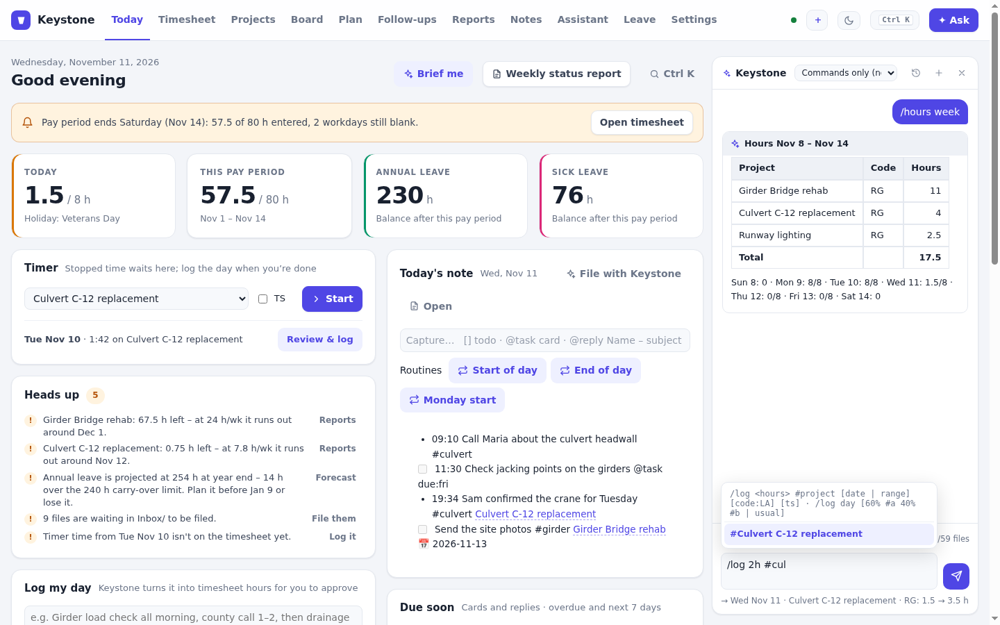

| Keys in the assistant box | |
| --- | --- |
| `Enter` | Run |
| `Tab` | Accept the highlighted suggestion |
| `↑` / `↓` | Move through suggestions, or bring back earlier commands (when the box is empty or starts with `/`) |
| `Esc` | Close the suggestions |
| `Shift+Enter` | A new line, for typing [several commands](#8-several-actions-at-once) |

| The palette in `/` mode | Quick capture shows what a command will do |
| --- | --- |
| 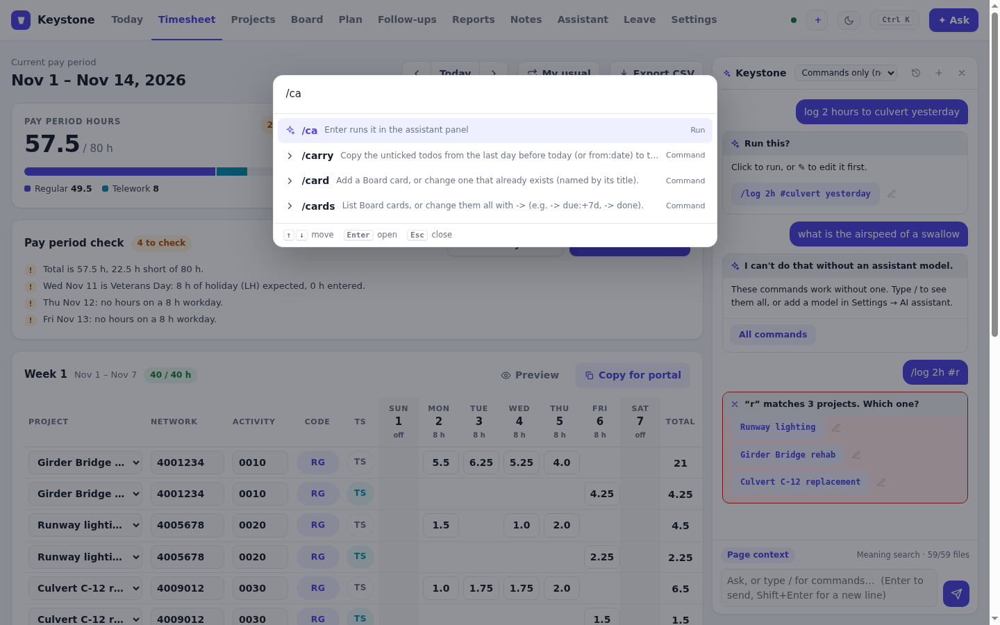 | 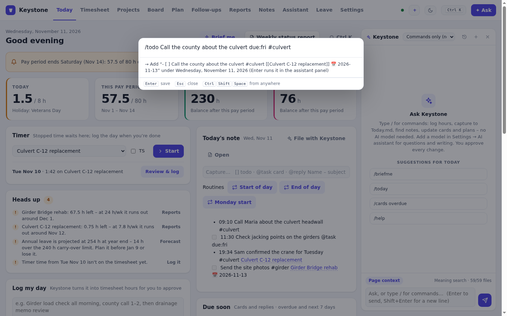 |

`/help` lists every command in the app, and `/help log` explains one. The full reference is
**[COMMANDS.md](COMMANDS.md)**.

## 3. How a command works

**Look-ups run straight away** (`/hours`, `/cards overdue`, `/grep TBD`) and show a card in the panel.

**Changes show a preview first.** Hours go from 1.5 to 3.5, a card is added with a due date, a note gets a new line.
Press **Apply** or **Reject**. Afterwards every change has **Undo**. Changes to notes are also saved in the vault's
Git history if you use it. Lines added to Today.md go straight in, with Undo, because adding a line is easy to take
back. You can change how often Keystone asks in [Settings](#10-settings).

**Names are never guessed.** `#r` matches three projects, so Keystone asks which one you mean, with a button for
each. Nothing is changed until you pick one. A name that matches nothing gets "did you mean" suggestions.

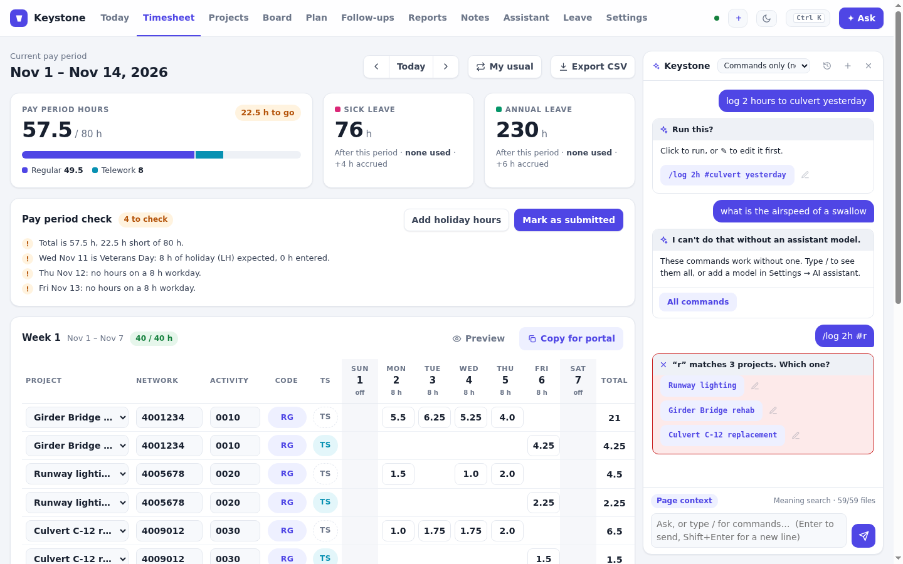

### How to write the parts

| What | Forms |
| --- | --- |
| **Dates** | `today`, `yesterday`, `tomorrow`, `mon`…`sun`, `last fri`, `next mon`, `+3d`, `-2d`, `+1w`, `2026-11-03`, `11/3`, `nov 3`. Logging looks back (`/log 2h #girder mon` is the last Monday). Due dates look forward (`due:mon` is the next Monday). |
| **Ranges** | `mon..fri`, `nov 17..nov 28`, `this week`, `last week`, `this period`, `last period` |
| **Hours** | `2h`, `1.5h`, `90m`, `2:30`, `2h30` |
| **Projects** | `#girder`: any part of the name, or the network number. Use `#"Girder Bridge rehab"` for an exact name. |
| **People** | `@Maria`, `@"Sam Ortiz"`, `@Maria[50%]` (for plan assignments) |
| **Notes** | `[[Note name]]` or `"Note name"`. `today` means Today.md and `this` means the note that's open. |
| **Options** | `key:value`, e.g. `due:fri`, `status:doing`, `in:Projects`, `plan:girder`, `title:"New title"` |
| **Text after a target** | `/append <note> :: <text>` |

## 4. Your first day

This is what a normal day looks like with commands only. Every step also has a button somewhere in the app;
commands are just quicker.

**Morning.** Click **Start of day** on the Today page, or type `/start`. It carries yesterday's unticked todos
forward and shows a briefing: hours still needed, cards overdue and due soon, replies you owe, leave, and notes
you changed recently. **Brief me** on the Today page shows the same briefing.

**During the day,** capture as you go:

```
/note Sam confirmed the crane for Tuesday #culvert       a timestamped line in Today.md, linked to the project
/todo Send the site photos due:fri #girder               a checkbox with a due date
/log 2h #girder                                          two hours on today's timesheet
/timer start #culvert                                    or time it instead; /timer stop when you switch
/fu Maria – Headwall detail due:+2d #culvert             an email you must answer, in Follow-ups
```

`/today` shows today's lines numbered, and `/done 2` ticks the second one. `/done photos` works too, and so does
`/done 2, 4`.

**End of day.** Click **End of day**, or type `/eod`. It fills the rest of the day from **My usual** on the Timesheet,
then shows today's note. If hours are already logged, the fill is skipped and Keystone tells you why. To split
the day yourself, type `/log day 60% #girder 40% #culvert`.

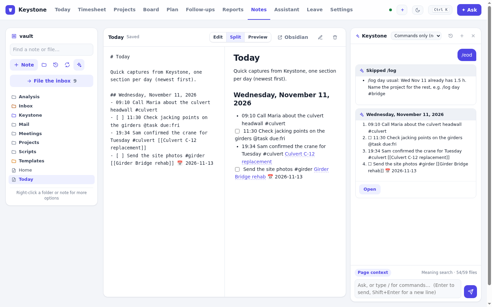

Then **file the day.** Type `/file-today`, or click **File with Keystone** on the Today page. A table lists each line
of today with where it should go:
- a `#project` line goes into that project's note under `## Log`;
- a todo with a project or a date becomes a Board card;
- a reply becomes a follow-up;
- an untagged line stays where it is unless you pick a note for it.

Untick anything you don't want filed, then press **File**. Filed lines are marked `→ [[where it went]]` in Today.md.

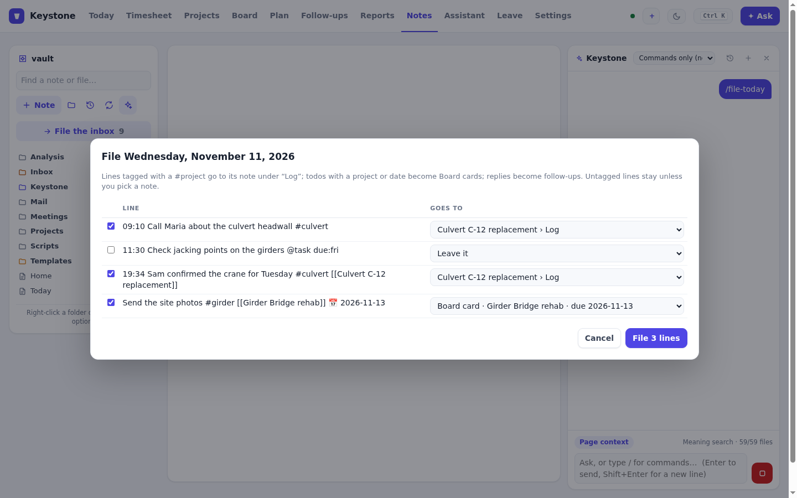

**Friday.** `/weekly` writes your weekly status note from hours by project, cards done and due, notes changed and
the week in Today.md. It uses your "Keystone – Weekly status" template if you have one. **Weekly status report** on
the Today page does the same. Add `last` for last week's note.

**End of pay period.** `/left` shows what's still missing. `/period` opens the pay-period check on the Timesheet.
**Copy for portal**, paste, then **Mark as submitted**.

## 5. Adding tasks: which kind, and how

Keystone has four places for "something to do". Pick by how long it lives and who needs to see it:

| Kind | Use it for | Add | Change | List |
| --- | --- | --- | --- | --- |
| **Todo in Today.md** | Small things for today or this week | `/todo Call the county due:fri #culvert` | `/done 2`, `/undone 2`, `/carry` | `/today`, `/todos` |
| **Board card** | Deliverables you track to a due date | `/card Pad drawings review #girder due:fri` | `/card pad drawings doing`, `/card pad drawings due:+3d`, `/card pad drawings done` | `/cards`, `/cards week #girder` |
| **Follow-up** | An email you owe a reply | `/fu Maria – Bearing pad submittal due:+2d #girder` | `/fu bearing pad done`, `/fu bearing pad waiting` | `/fus`, `/fus overdue` |
| **Plan task** | Scheduled work with durations, links and people | `/addtask "Pad design" 3d after:7 @Maria` | `/task 12 50%`, `/task 12 +2d`, `/task 12 finish:fri` | `/tasks`, `/late` |

A todo can become something bigger later:
- `/file-today` turns dated or project todos into Board cards;
- `/actions this | todo` pulls the action items out of a meeting note into today;
- `/actions "County meeting" | card #culvert` turns the same items into Board cards.

To change a card or follow-up, name it by part of its title (`/card pad drawings done`). If two match, you get a
choice.

## 6. Everything else, area by area

### Timesheet, leave and budget

| To… | Type |
| --- | --- |
| Log hours | `/log 2h #girder` · `/log 1.5h #culvert yesterday` · `/log 2h #girder, 1.5h #culvert, 0.5h #runway yesterday` |
| Log a whole week | `/log 8h #girder mon..fri` (scheduled working days only; add `all` for days off too) |
| Fill the rest of the day | `/log day #girder` · `/log day 60% #girder 40% #culvert` · `/log day usual` |
| Log leave or other codes | `/log 8h code:LA fri` |
| See hours | `/hours` · `/hours yesterday` · `/hours week` · `/hours last period` |
| What's still missing | `/left` |
| Leave balances, now and at year end | `/leave` |
| Budget left and burn rate | `/budget` · `/budget #girder` |
| Time out of office | `/away annual dec 22..dec 31 "Holidays"` (opens the dialog, filled in) |
| Timer | `/timer start #girder` · `/timer stop` · `/timer` |
| Pay-period check, CSV export | `/period` · `/export` |

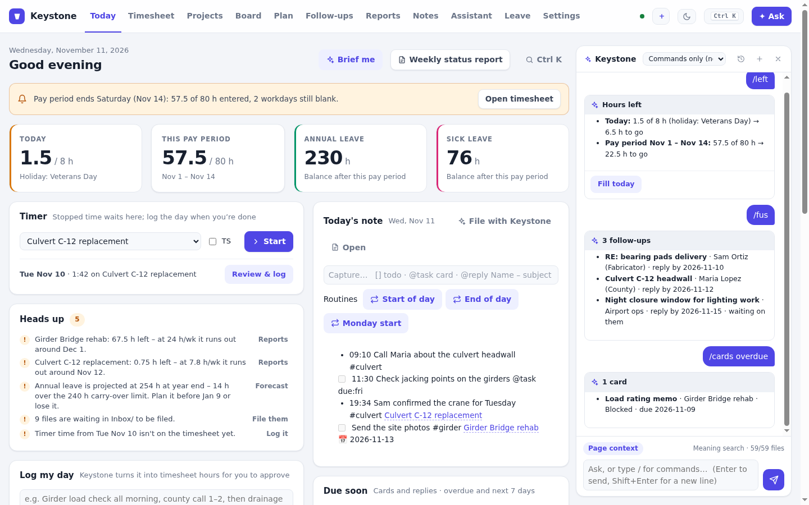

### Board and follow-ups

| To… | Type |
| --- | --- |
| Add a card | `/card Crane lift plan #culvert due:+5d` · `/card Spec review status:doing` |
| Change a card | `/card crane lift doing` · `/card crane lift due:+3d` · `/card crane lift title:"Crane lift plan rev B"` · `/card old duplicate remove` |
| List cards | `/cards` · `/cards overdue` · `/cards week #girder` · `/cards doing` |
| Change many cards | `/cards overdue -> due:+7d` · `/cards #girder doing -> done` (see [Bulk changes](#bulk-changes-with--)) |
| Add an email to answer | `/fu Sam Ortiz – Bearing pads delivery due:tomorrow #girder` |
| Change follow-ups | `/fu bearing pads done` · `/fu bearing pads waiting` · `/fus today -> due:tomorrow` |
| Start a reply | `/reply bearing pads`, or **Draft reply** on a follow-up. Without a model you get a reply skeleton to copy and fill in. |

### Notes and the vault

| To… | Type |
| --- | --- |
| Open a note or file | `/open load check` · `/open [[County meeting]]` · `/open today` |
| Browse | `/ls` · `/ls Projects/Bridge` · `/map` (folders with counts and examples) · `/recent 3d` · `/templates` |
| Create a note | `/new "Pad design memo" tpl:Memo in:Projects/Bridge` · `/meeting #girder` (today's meeting note from your meeting template) |
| Add to a note | `/append "Bridge open questions" :: - Who owns the drainage?` · `/append today :: Site visit went well` |
| Replace a passage | `/replace "Load check" :: w = 18 kN/m => w = 20 kN/m` (the old text must appear exactly once) |
| Move or rename | `/move "Inbox/girder_v3.inp" to Projects/Bridge/FE` · `/rename "Load check" to "Load check – girders"` (never overwrites; links are listed, not changed) |
| Links and related notes | `/backlinks` (what links to the open note) · `/related` (notes similar in meaning) |
| Action items in a note | `/actions` · `/actions "County meeting"` (open checkboxes, `TODO:`, `Action:`, `AI:` lines) |
| File the inbox | `/inbox` (a table of suggested folders from similar files, reviewed before anything moves) · `/where "Inbox/girder_v3.inp"` |

Keystone never deletes a note. Moves and renames refuse to overwrite an existing file.

### Project plans

Plan commands work on the plan that's open on the Plan tab. If no plan is open, they use your only plan. If you
have several, they ask which one, or you can add `plan:girder`.

| To… | Type |
| --- | --- |
| Open a plan | `/plans` · `/plan girder` |
| What's late, critical, next | `/late` · `/critical` · `/next` · `/tasks late` · `/tasks @Maria` |
| Change a task (by its ID, the row number) | `/task 12 50%` · `/task 12 +2d` (2 days later) · `/task 12 3d` (duration) · `/task 12 finish:fri` · `/task 12 @Maria[50%]` · `/task 12 after:7SS+2d` · `/task 12 hours:40 budget:$4k` |
| Try a change without saving | `/whatif 12 +5d` |
| Add tasks and milestones | `/addtask "Agency review" 2w after:12 @Maria` · `/milestone "60% plans" 2026-12-12` |
| Issues and risks | `/risk Pad delivery slips p:3 i:4 @Sam` · `/issue County comments late @Maria due:fri` · `/action Send revised calcs @Sam due:fri` · `/decision Use elastomeric pads` |
| Cost and people | `/cost` (earned value and forecast) · `/free nov 17..nov 28` (who has time) · `/portfolio` (every plan on one line) |
| Weekly status | `/status` (suggested red/amber/green with reasons) · `/close-week amber reason:"FE model two days late"` · `/update win County approved the 30% plans` |
| Brief and sharing | `/brief` · `/share` · `/costs import` |

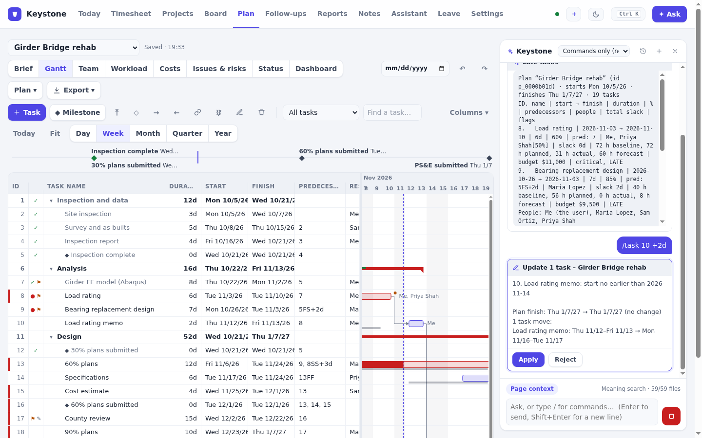

### Moving around

`/go board` (or `today`, `timesheet`, `projects`, `plan`, `followups`, `leave`, `reports`, `notes`, `settings`),
`/theme dark`, `/help`, `/undo` (the last change made in this chat).

## 7. Finding things: search, grep and todos

There are three ways to search, and none of them needs a model:

| Command | Finds | Use it when |
| --- | --- | --- |
| `/find bearing replacement` | Notes and documents by **keywords and meaning**, ranked. Meaning search uses a small embedding model that runs in your browser. | You know what it's about, not the exact words |
| `/grep TBD` | **Every line** that contains the exact text, with the file and line number | You know the words: a spec number, a node ID, `TBD`, a name |
| `/todos` | **Every open checkbox** in the vault, with due dates (`📅 2026-11-20` or `due:2026-11-20`) | You want one list of all the loose ends in your notes |

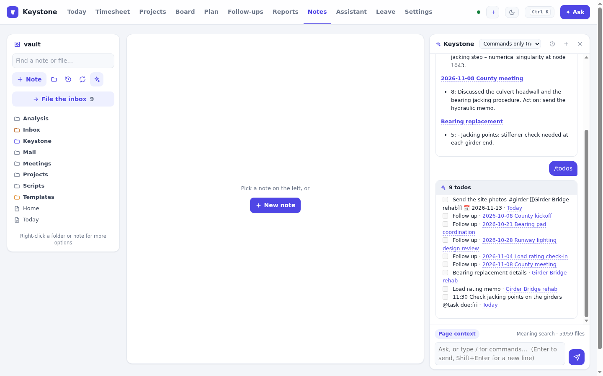

**`/grep` options:**
- `in:Projects/Bridge` searches one folder.
- `case` matches upper and lower case exactly.
- `docs` also searches text extracted from PDFs, Word and Excel files (when document reading is on).
- `re` makes it a regular expression: `/grep "\d+ kips" re`. Without `re`, the text is matched literally, so
  `d.ck` finds "d.ck", not "deck".

It skips the Keystone folder of generated notes (search it with `in:Keystone`) and files over 2 MB, and it stops
after 3 seconds. Patterns that could run for a very long time are refused.

**`/todos` filters:** `overdue`, `today`, `week`, `due:fri`, `#girder`, `in:Projects`, or `done` and `all` to see
ticked ones. Checkboxes in your templates folder are left out.

Results can be sent on to another command (see [Pipes](#pipes-with-)):

```
/find "load rating" | append today                       links to the matching notes, under today in Today.md
/grep "#girder" in:Inbox | move Projects/Bridge          move every inbox file that mentions #girder
/todos overdue -> due:+7d                                push every overdue checkbox a week (each is shown first)
/todos #girder -> done                                   tick them all
```

## 8. Several actions at once

You don't need a model to do several things in one go.

### Lists and ranges

A date at the end applies to every part:

```
/log 2h #girder, 1.5h #culvert, 0.5h #runway yesterday
/log 8h #girder mon..fri
/done 2, 4
```

### Chains

Separate commands with `;`, a new line (`Shift+Enter`) or `then`. Keystone checks every command before running any
of them. If one has a problem (a project that doesn't exist, an ambiguous name), you're told before anything
changes. Otherwise you get **one preview with a tick box per change**. Untick what you don't want, then
**Apply all**. The commands run in order and stop at the first problem.

```
/note Pier 3 bearings inspected, no section loss #girder ; /todo Ask Sam for the crane quote due:mon #culvert ; /log 1.5h #culvert ; /card Crane lift plan #culvert due:+5d
```

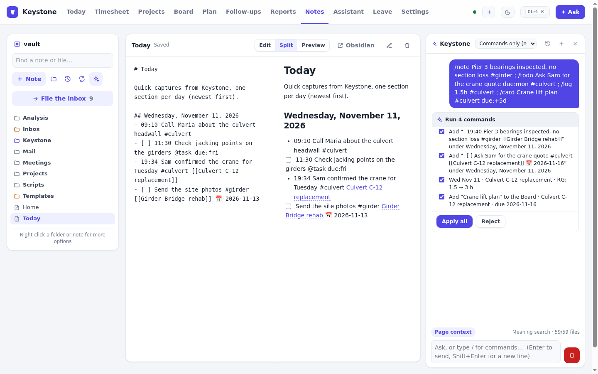

Afterwards, **Undo all** reverses the whole chain, newest change first:

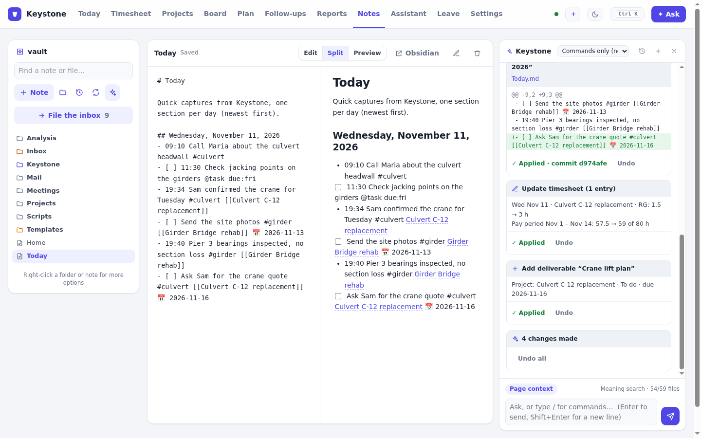

### Bulk changes with `->`

A list command followed by `->` and a change applies that change to everything on the list:

```
/cards overdue -> due:+7d        /cards #girder doing -> done
/fus today -> due:tomorrow       /todos overdue -> done
/tasks late -> +2d
```

Bulk changes are **always** shown first, with a tick box per item, whatever your confirmation setting.

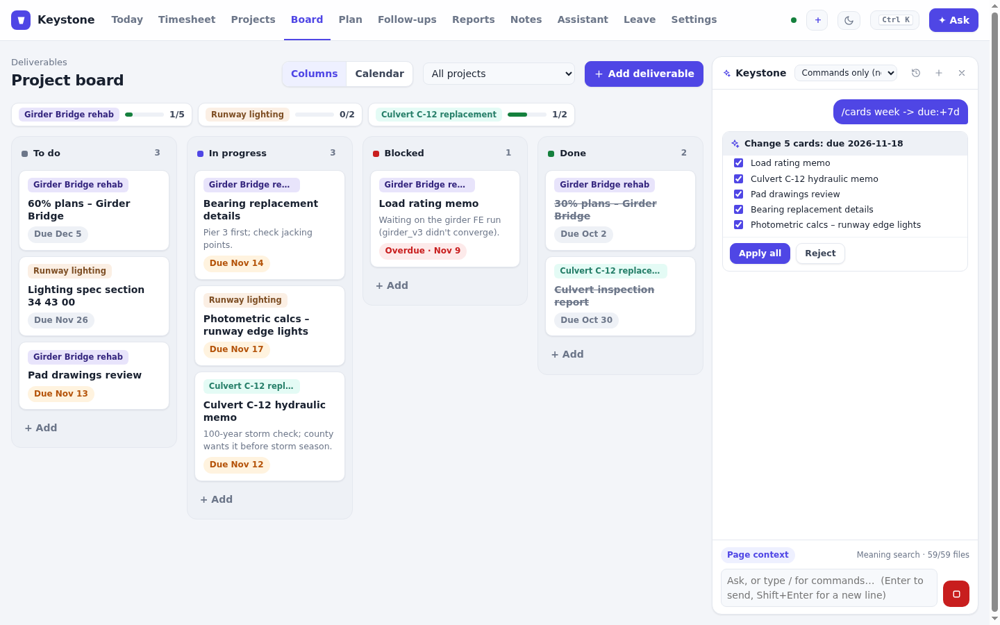 due:+7d in the panel: Change 5 cards: due 2026-11-18, with a tick box for each card and Apply all or Reject" width="900">

### Pipes with `|`

A list from one command can feed the next. Look-ups that produce a list include `/find`, `/grep`, `/recent`,
`/actions`, `/todos`, `/cards` and `/fus`. Commands that accept a list include `/note`, `/todo`, `/append`,
`/card`, `/open` and `/move`.

```
/actions this | todo                   every action item in the open note becomes a todo for today
/recent 3d | append today              links to what you changed in the last three days
/find bearing | note                   one note line per match
```

### `$`: what the last command made

```
/new "Pad memo" tpl:Memo ; /append $ :: Started the pad design
```

### Routines

A routine is a saved list of commands with a name, such as `/start`, `/eod` or `/monday`. It appears as a button on
the Today page. Edit routines in **Settings → Slash commands → Routines**. Each routine is a `name: Label` line
followed by one command per line, with a blank line between routines:

```
start: Start of day
?/carry
/briefme

eod: End of day
?/log day {1|usual}
/today

monday: Monday start
/weekly last
/cards week
/fus overdue
```

- `{1}` is the first word you type after the routine's name. `{1|usual}` uses `usual` when you don't type one, so
  `/eod #girder` fills the day on Girder and `/eod` uses your usual split.
- A line starting with `?` is **skipped when it doesn't apply**. With nothing to carry, or the day already full, the
  routine carries on and tells you why.
- Run a routine with `/name`, `/run name`, the palette, or its button on Today. `/routines` lists them.

## 9. Plain text without a slash

You can also type ordinary sentences. Without a model, Keystone tries to match them to a command:
- **Clear rules** recognise common phrasings. "log 2 hours to culvert yesterday" becomes `/log 2h #culvert yesterday`
  and "what's overdue" becomes `/cards overdue`.
- **Meaning** catches the rest. A small model in your browser compares the sentence with example phrasings and offers
  the closest commands.

Look-ups found by a rule run straight away. Anything that changes data is only **suggested**, as a button you click
(or ✎ to edit first). Nothing is changed from a guess. If nothing fits, Keystone says so and offers the list of
commands. `/why <sentence>` shows how a sentence was understood, if you're curious.

## 10. Settings

**Settings → Slash commands:**

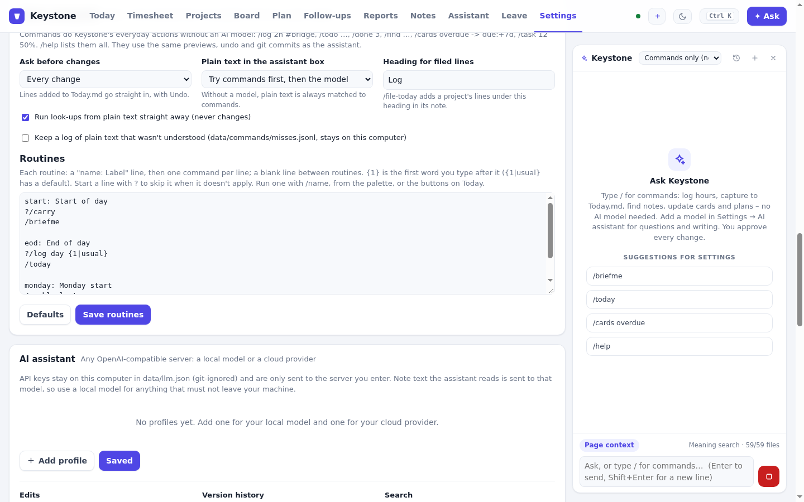

| Setting | Choices |
| --- | --- |
| **Ask before changes** | **Every change** (default), **Only several or bulk changes**, or **Never** (bulk changes still ask). Lines added to Today.md always go straight in, with Undo. |
| **Plain text in the assistant box** | Only matters once you add a model: **Try commands first, then the model**, or **Always the model**. Without a model, plain text is always matched to commands. |
| **Heading for filed lines** | The heading `/file-today` writes under in a project's note (default `Log`). |
| **Run look-ups from plain text straight away** | On by default. Turn it off to have even look-ups suggested as buttons. |
| **Keep a log of plain text that wasn't understood** | Off by default. Saves those sentences to `data/commands/misses.jsonl`, on this computer only, to help add phrasings later. |
| **Routines** | See [Routines](#routines). **Defaults** restores the three built-in ones. |

## 11. What still needs a model

A small number of things need language understanding, not just matching:
- free-form questions ("why is the finish date slipping?");
- writing a reply or a summary for you;
- reading a document and explaining it;
- turning a free-text description of your day ("girder all morning, county call 1–2…") into hours.

Without a model, the buttons for these do the closest thing that works offline:
- **Brief me** runs `/briefme`.
- **Weekly status report** runs `/weekly`.
- **File with Keystone** opens the `/file-today` table.
- **Draft reply** gives you a reply skeleton.
- **Log my day** starts a `/log` command for you to finish.

When you're ready, add a model in **Settings → AI assistant**: a local one (Gemma or Llama through llama.cpp,
Ollama or LM Studio) or a cloud provider. Commands keep working exactly as before. With a model, `/ask <question>`
sends a question to it directly. See [AI assistant](GUIDE.md#ai-assistant-ask-keystone) in the user guide.

---

**See also:** [COMMANDS.md](COMMANDS.md) (every command, generated from the code) ·
[User guide → Slash commands](GUIDE.md#slash-commands-no-ai-model-needed) · [README](../README.md)
